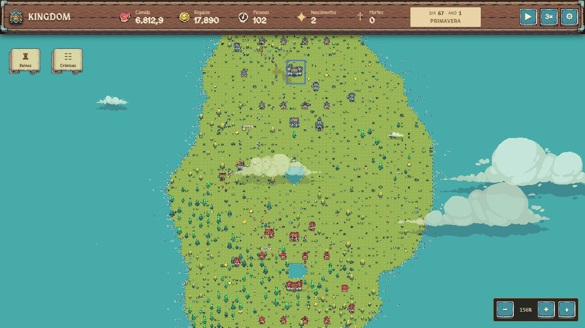

# Verificação do combate

Resultado na versão atual do checkout: **25 testes aprovados, nenhuma falha; build de produção aprovado**.

Os testes mencionados na entrega anterior não estavam presentes neste checkout, e o `package.json` já não tinha comando de teste. Esta verificação criou uma suíte nova em `tests/` e adicionou `npm test`. Os resultados antigos de 48 testes e das quatro falhas anteriores não foram reutilizados como evidência da versão atual.

## Correções verificadas por regressão

1. **Ordem de contato da espada.** Dois corpos podiam entrar no arco dentro do mesmo subpasso. O resolvedor ordenava pela distância ao longo da lâmina e podia atingir o corpo que entrou depois. A consulta agora calcula a primeira interseção angular da lâmina finita com cada corpo/guarda e ordena por tempo, usando distância para desempate. O teste repete o cenário em 24 rotações e alterna a ordem dos candidatos.
2. **Flecha cancelada após o disparo.** O avanço de ponto flutuante podia ultrapassar 500 ms enquanto ainda tratava o intervalo como preparação. A morte do arqueiro nesse intervalo cancelava uma flecha já disparada. Os passos agora se dividem exatamente no marcador de disparo.
3. **Intercepção por altura incorreta.** A flecha podia passar acima de um corpo e depois descer à altura dele dentro de um mesmo subpasso, gerando um contato retroativo com o trecho horizontal anterior. A consulta agora restringe o segmento ao intervalo de altura válido antes de procurar a interseção. A altura efetiva do contato também acompanha o evento e o término do efeito visual.
4. **Relógios incompatíveis na movimentação visual.** Os snapshots eram registrados com `performance.now()`, mas as posições eram consultadas com o relógio pausável/acelerável das animações. A interpolação voltou a consultar o relógio real, mantendo a mesma base temporal das amostras.

Também foi acrescentada a exclusão de estruturas já destruídas na consulta de contato.

## Cobertura reproduzível

Executar com o Node instalado no ambiente (v24.19.0):

```powershell
npm test
npm run build
```

| Suíte | Testes | Cobertura |
| --- | ---: | --- |
| `tests/combat-contact.test.mjs` | 19 | Fases, corpo, escudo frontal/costas, lança em guarda, esquiva, alcance, ordem temporal, altura, primeiro inimigo, aliados e abrigados, morte após disparo, deduplicação, histórico limitado, efeitos e contrato temporal da interpolação |
| `tests/combat-integration.test.mjs` | 5 | Captura com piso de 25% e cinco dias de ocupação; destruição, vigia e saque sem duplicação; morte e baixa única; estamina e cura; altura visual de interceptação e descarte de eventos antigos |
| `tests/combat-worker.test.mjs` | 1 | Entry point de produção em Worker isolado, mensagens e buffers transferidos, campanha real, limites de atributos, pausa, avanço manual e em lote, reset e rejeição de época antiga, repetição determinística |

O teste do Worker usa o entry point real `simulation.worker.ts`, adaptando somente as APIs de mensagens do navegador ao `worker_threads`. Não usa substituto para o resolvedor, geração do mundo, economia ou campanhas. No seed 42, avançou até o **dia 192**, com **28 ações de combate e uma campanha**. Após reset, repetiu os primeiros 12 dias e comparou pessoas, estruturas e colunas escalares dos tiles. A execução final da suíte levou aproximadamente 64 segundos.

Logs: [testes](tests.txt), [build](build.txt). O build conserva o aviso de tamanho de um bundle acima de 500 kB; não houve erro de compilação.

## Conferência no navegador

Foram exercitados carregamento do mapa/Worker, velocidades 1× → 2× → 3×, pausa, retomada, zoom e inspeção de campanha. O painel mostrou uma campanha em combate e o objetivo com vida reduzida no dia 67. Após pausar em 3×, o dia permaneceu estável entre observações. Captura de tela do mapa com a campanha ativa, pausado no dia 67:



A conferência visual não comprova alinhamento de cada pixel da arma com a hitbox nem todas as animações de impacto; os contatos e seus marcadores foram verificados pelos testes automatizados.

## Limites que permanecem

- Cada ação continua sendo resolvida de forma síncrona em subpassos da rodada diária. Não há relógio contínuo compartilhado entre combatentes nem interrupções concorrentes entre preparações de ataques distintos.
- Vida, barras e desaparecimento de mortos ainda seguem o snapshot diário; não foi implementado atraso visual de morte até o instante do impacto.
- Árvores e construções intermediárias ainda não bloqueiam o voo de flechas. Os perfis de arma/corpo/guarda continuam sujeitos à calibração artística e ao balanceamento.
- A execução determinística cobre um seed e esta sequência de comandos; não comprova balanceamento de longo prazo para todos os mundos.

Esses limites são de escopo arquitetural e apresentação, e não foram declarados resolvidos por esta verificação.
